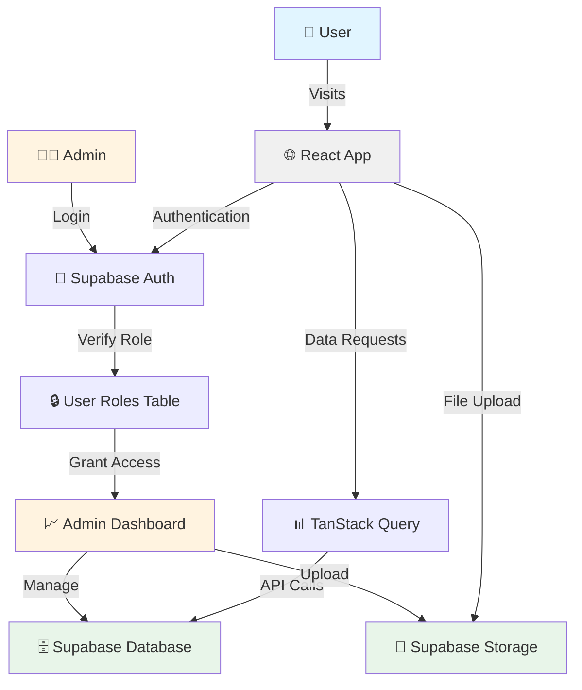
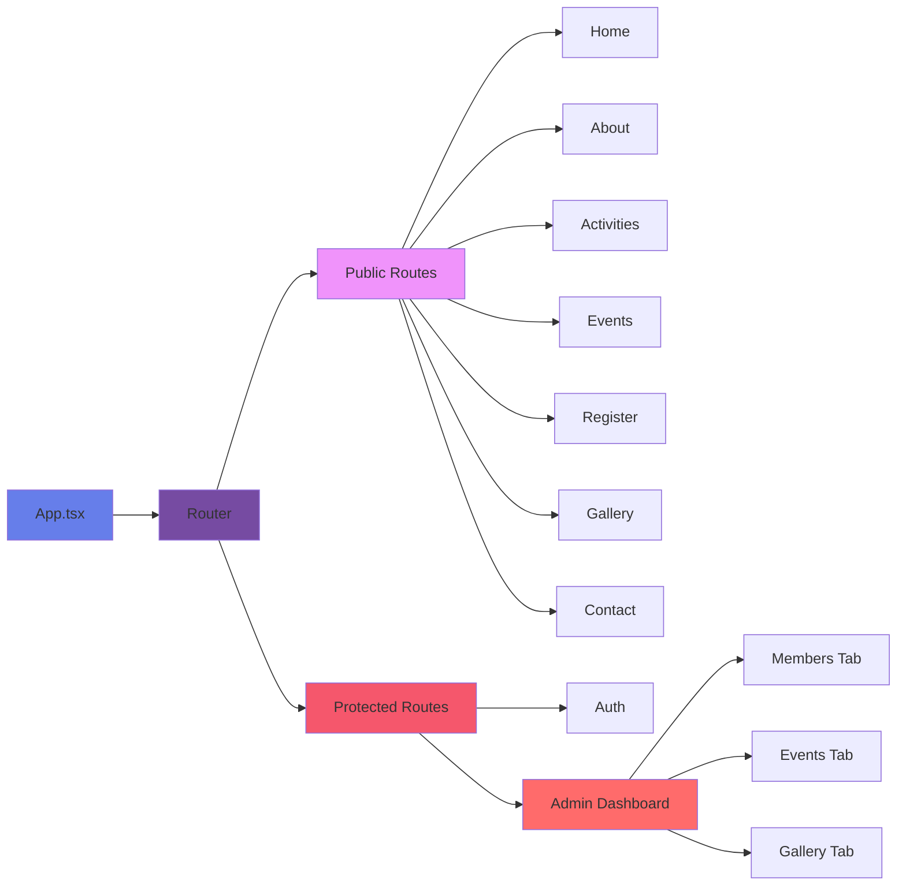
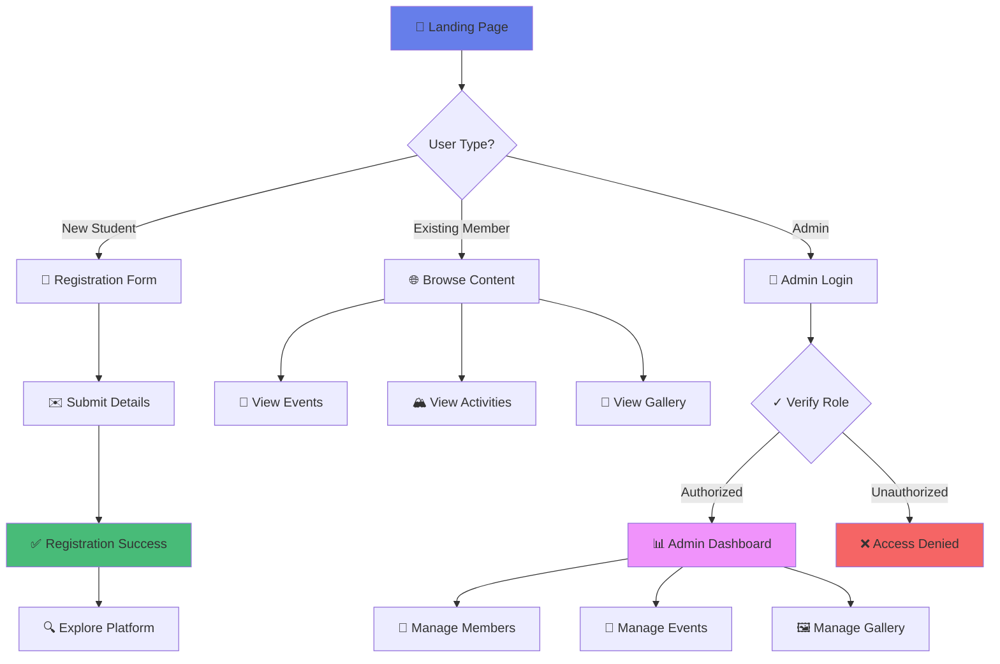
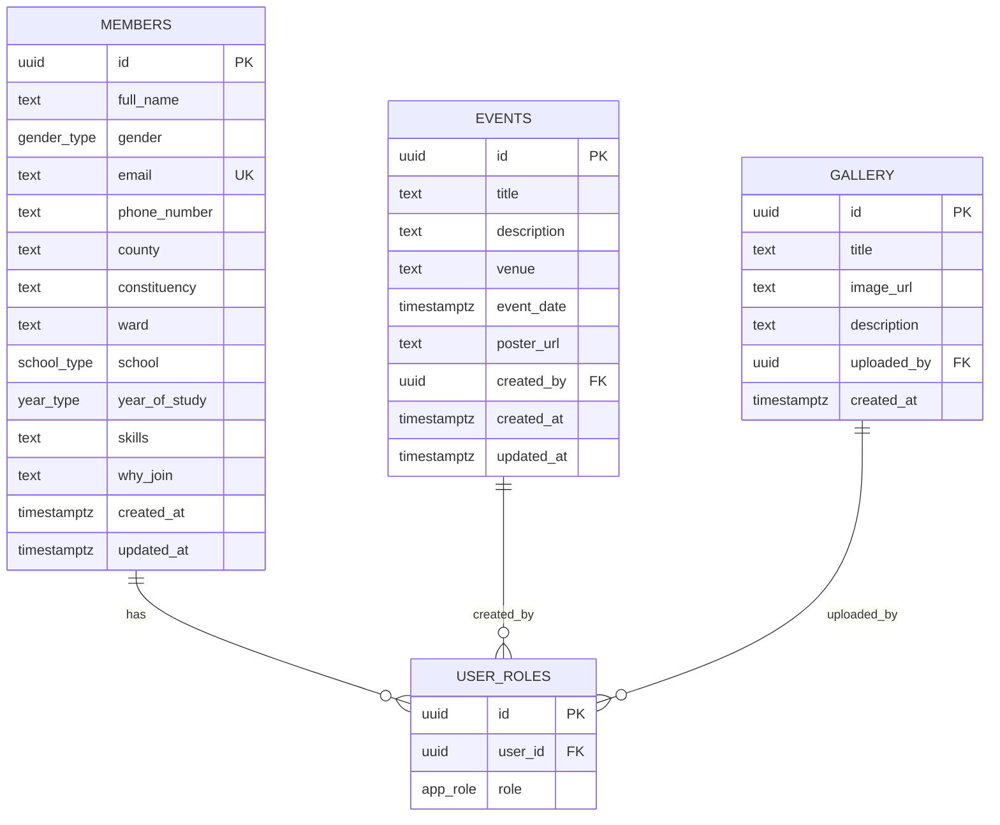

# 🎓 E-MUST - Embu County Students Association at MUST

<div align="center">


**Building Unity, Fostering Excellence** 🌟

[](https://www.typescriptlang.org/)
[](https://reactjs.org/)
[](https://vitejs.dev/)
[](https://supabase.com/)
[](https://tailwindcss.com/)

</div>

---

## 📖 Table of Contents

- [Overview](#-overview)
- [Features](#-features)
- [Technology Stack](#-technology-stack)
- [Architecture](#-architecture)
- [Database Schema](#-database-schema)
- [Getting Started](#-getting-started)
- [Project Structure](#-project-structure)
- [Configuration](#-configuration)
- [Usage](#-usage)
- [Admin Dashboard](#-admin-dashboard)
- [Deployment](#-deployment)
- [Contributing](#-contributing)
- [License](#-license)

---

## 🌟 Overview

**E-MUST** (Embu County Students Association at MUST) is a comprehensive web platform designed to unite and empower students from Embu County studying at Meru University of Science and Technology (MUST). The platform serves as a central hub for community building, event management, and student engagement.

### 🎯 Mission

To create a vibrant, supportive community where Embu County students can connect, collaborate, and excel academically and socially.

### 👁️ Vision

A thriving network of students committed to unity, excellence, and positive impact both within and beyond the university.

### 💡 Core Values

- **🤝 Unity** - Strength through togetherness
- **❤️ Care** - Supporting each other's wellbeing
- **🎯 Excellence** - Striving for academic and personal success
- **🔭 Vision** - Building a brighter future together

---

## ✨ Features

### 🏠 For Students

- **📝 Easy Registration** - Simple online registration form with validation
- **📅 Event Management** - Stay updated with upcoming events and activities
- **📸 Photo Gallery** - Browse photos from past events and activities
- **🏔️ Activities Showcase** - Explore various activities including:
  - Mountain hiking and outdoor adventures
  - Charity and community outreach programs
  - Social events and games
  - Academic support and study groups
- **📱 Responsive Design** - Seamless experience on all devices
- **🌐 Contact & Support** - Easy way to reach out to leadership

### 👨‍💼 For Admins

- **🔐 Secure Authentication** - Role-based access control with Supabase Auth
- **👥 Member Management** - View, update, and manage member registrations
- **📊 Event Administration** - Create, update, and delete events with poster uploads
- **🖼️ Gallery Management** - Upload and manage photo galleries
- **📈 Dashboard Analytics** - Overview of members, events, and activities
- **🔒 Data Privacy** - Row-level security policies for data protection

---

## 🛠️ Technology Stack

### Frontend

| Technology | Purpose | Version |
|------------|---------|---------|
| ⚛️ **React** | UI Framework | 18.3.1 |
| 📘 **TypeScript** | Type Safety | 5.8.3 |
| ⚡ **Vite** | Build Tool | 5.4.19 |
| 🎨 **Tailwind CSS** | Styling | 3.4.17 |
| 🎭 **shadcn/ui** | UI Components | Latest |
| 🗺️ **React Router** | Routing | 6.30.1 |
| 🔄 **TanStack Query** | Data Fetching | 5.83.0 |
| 📋 **React Hook Form** | Form Management | 7.61.1 |
| ✅ **Zod** | Schema Validation | 3.25.76 |
| 🎯 **Lucide React** | Icons | 0.462.0 |

### Backend

| Technology | Purpose |
|------------|---------|
| 🗄️ **Supabase** | Backend-as-a-Service |
| 🐘 **PostgreSQL** | Database |
| 🔐 **Supabase Auth** | Authentication |
| 💾 **Supabase Storage** | File Storage |
| 🔒 **Row Level Security** | Data Protection |

### Development Tools

- 📦 **npm** - Package Manager
- 🎨 **ESLint** - Code Linting
- 🔧 **PostCSS** - CSS Processing
- 📱 **Responsive Design** - Mobile-first approach

---

## 🏗️ Architecture

### Application Flow



### Component Architecture



### User Journey



---

## 🗃️ Database Schema



### 📊 Schema Details

#### Members Table
- Stores all registered student information
- Includes personal details, academic info, and skills
- Protected by RLS policies (only admins can view)

#### Events Table
- Manages all association events
- Includes event details, dates, and poster images
- Public read access, admin-only write access

#### Gallery Table
- Stores event photos and images
- Supports image uploads to Supabase Storage
- Public viewing, admin management

#### User Roles Table
- Manages admin access control
- Links users to their roles (admin/member)
- Protected by strict RLS policies

---

## 🚀 Getting Started

### Prerequisites

- **Node.js** (v18+ recommended) - [Download](https://nodejs.org/)
- **npm** (v9+) or **yarn**
- **Git** - [Download](https://git-scm.com/)
- **Supabase Account** - [Sign Up](https://supabase.com/)

### Installation

1️⃣ **Clone the Repository**

```bash
git clone https://github.com/lewiii254/embu-connect-must.git
cd embu-connect-must
```

2️⃣ **Install Dependencies**

```bash
npm install
# or
yarn install
```

3️⃣ **Environment Setup**

Create a `.env` file in the root directory:

```env
VITE_SUPABASE_PROJECT_ID=your_project_id
VITE_SUPABASE_URL=https://your-project.supabase.co
VITE_SUPABASE_PUBLISHABLE_KEY=your_anon_key
```

4️⃣ **Start Development Server**

```bash
npm run dev
# or
yarn dev
```

The application will be available at `http://localhost:8080` 🎉

---

## 📁 Project Structure

```
embu-connect-must/
├── 📂 public/                  # Static assets
│   ├── favicon.ico
│   ├── placeholder.svg
│   └── robots.txt
│
├── 📂 src/
│   ├── 📂 assets/              # Images and media
│   │   ├── hero-image.jpg
│   │   ├── activities-hiking.jpg
│   │   ├── activities-charity.jpg
│   │   └── embufest-poster.png
│   │
│   ├── 📂 components/          # Reusable components
│   │   ├── 📂 ui/              # shadcn/ui components
│   │   ├── 📂 admin/           # Admin-specific components
│   │   ├── Navbar.tsx
│   │   ├── Footer.tsx
│   │   └── NavLink.tsx
│   │
│   ├── 📂 pages/               # Page components
│   │   ├── Home.tsx            # Landing page
│   │   ├── About.tsx           # About the association
│   │   ├── Activities.tsx      # Activities showcase
│   │   ├── Events.tsx          # Events listing
│   │   ├── Register.tsx        # Member registration
│   │   ├── Gallery.tsx         # Photo gallery
│   │   ├── Contact.tsx         # Contact page
│   │   ├── Auth.tsx            # Authentication
│   │   ├── NotFound.tsx        # 404 page
│   │   └── 📂 admin/
│   │       └── Dashboard.tsx   # Admin panel
│   │
│   ├── 📂 hooks/               # Custom React hooks
│   ├── 📂 lib/                 # Utility functions
│   ├── 📂 integrations/        # External integrations
│   │   └── 📂 supabase/
│   │       └── client.ts       # Supabase client
│   │
│   ├── App.tsx                 # Main app component
│   ├── main.tsx                # Entry point
│   └── index.css               # Global styles
│
├── 📂 supabase/                # Supabase configuration
│   ├── config.toml
│   └── 📂 migrations/          # Database migrations
│
├── 📄 package.json             # Dependencies
├── 📄 tsconfig.json            # TypeScript config
├── 📄 tailwind.config.ts       # Tailwind config
├── 📄 vite.config.ts           # Vite config
└── 📄 README.md                # Documentation
```

---

## ⚙️ Configuration

### Tailwind CSS Theme

The project uses custom color schemes defined in `tailwind.config.ts`:

- 🌲 **forest-green** - Primary brand color
- 🍃 **medium-green** - Secondary shade
- ☀️ **bright-yellow** - Accent color
- 🌿 **light-green** - Complementary color

### Supabase Setup

1. Create a new Supabase project
2. Run the migration in `supabase/migrations/`
3. Create an admin user manually in Supabase
4. Add the user to `user_roles` table with role='admin'
5. Configure storage bucket `emust-images` for image uploads

### Environment Variables

| Variable | Description | Required |
|----------|-------------|----------|
| `VITE_SUPABASE_PROJECT_ID` | Supabase project ID | ✅ Yes |
| `VITE_SUPABASE_URL` | Supabase API URL | ✅ Yes |
| `VITE_SUPABASE_PUBLISHABLE_KEY` | Supabase anon/public key | ✅ Yes |

---

## 💻 Usage

### Building for Production

```bash
npm run build
# or
yarn build
```

The production build will be in the `dist/` directory.

### Development Build

```bash
npm run build:dev
# or
yarn build:dev
```

### Linting

```bash
npm run lint
# or
yarn lint
```

### Preview Production Build

```bash
npm run preview
# or
yarn preview
```

---

## 👨‍💼 Admin Dashboard

### Accessing the Dashboard

1. Navigate to `/auth`
2. Sign in with admin credentials
3. You'll be redirected to `/admin` if authorized
4. Access denied if not an admin

### Dashboard Features

#### 👥 Members Tab
- View all registered members
- Search and filter members
- View member details (email, phone, school, etc.)
- Export member data

#### 📅 Events Tab
- Create new events with details
- Upload event posters
- Edit existing events
- Delete events
- View event registrations

#### 🖼️ Gallery Tab
- Upload new photos
- Add titles and descriptions
- Delete photos
- Organize gallery content

### Security Features

- 🔐 **Authentication Required** - Must be logged in
- 🛡️ **Role-Based Access** - Must have admin role
- 🔒 **Row Level Security** - Database-level protection
- ✅ **Input Validation** - Form validation with Zod
- 🚫 **CSRF Protection** - Built-in with Supabase

---

## 🌐 Deployment

### Deploying to Vercel

1. Push your code to GitHub
2. Import project in Vercel
3. Add environment variables
4. Deploy!

### Deploying to Netlify

1. Build the project: `npm run build`
2. Deploy the `dist/` folder
3. Configure environment variables
4. Set up redirects for SPA

### Using Lovable

Simply open [Lovable](https://lovable.dev/projects/0fc73b0f-9a92-4af4-9402-93b38cf613b8) and click Share → Publish.

### Custom Domain

You can connect a custom domain through your hosting provider or via Lovable's domain settings.

---

## 🤝 Contributing

We welcome contributions from the community! Here's how you can help:

### Development Workflow

1. **Fork the Repository**
   ```bash
   git clone https://github.com/lewiii254/embu-connect-must.git
   ```

2. **Create a Feature Branch**
   ```bash
   git checkout -b feature/your-feature-name
   ```

3. **Make Your Changes**
   - Follow the existing code style
   - Write meaningful commit messages
   - Test your changes thoroughly

4. **Commit Your Changes**
   ```bash
   git commit -m "feat: add your feature description"
   ```

5. **Push to Your Fork**
   ```bash
   git push origin feature/your-feature-name
   ```

6. **Open a Pull Request**
   - Describe your changes
   - Link related issues
   - Request review

### Commit Convention

We follow [Conventional Commits](https://www.conventionalcommits.org/):

- `feat:` - New feature
- `fix:` - Bug fix
- `docs:` - Documentation changes
- `style:` - Code style changes (formatting, etc.)
- `refactor:` - Code refactoring
- `test:` - Adding or updating tests
- `chore:` - Maintenance tasks

### Code of Conduct

- Be respectful and inclusive
- Welcome newcomers
- Focus on constructive feedback
- Help others learn and grow

---

## 📝 License

This project is licensed under the **MIT License**.

---

## 👥 Team & Contact

### Leadership

- **Chairman** - To be announced
- **Vice Chairman** - To be announced
- **Secretary** - To be announced
- **Treasurer** - To be announced
- **Programs Representative** - To be announced

### Get In Touch

- 📧 **Email**: Contact through the website
- 🌐 **Website**: [E-MUST Platform](https://lovable.dev/projects/0fc73b0f-9a92-4af4-9402-93b38cf613b8)
- 📱 **Social Media**: Follow us for updates

---

## 🙏 Acknowledgments

- **Lovable** - For the amazing development platform
- **Supabase** - For the robust backend infrastructure
- **shadcn/ui** - For the beautiful UI components
- **MUST Community** - For the support and feedback
- **All Contributors** - Thank you for making this project better!

---

## 📊 Project Status

🟢 **Active Development** - We're continuously improving the platform!

### Recent Updates

- ✅ Member registration system
- ✅ Event management
- ✅ Photo gallery
- ✅ Admin dashboard
- ✅ Responsive design
- 🔄 Analytics dashboard (In Progress)
- 📋 Event RSVP system (Planned)
- 💬 Member messaging (Planned)

---

<div align="center">

### 🌟 Star this repository if you find it helpful! 🌟

**Made with ❤️ by the E-MUST Community**

[⬆ Back to Top](#-e-must---embu-county-students-association-at-must)

</div>
